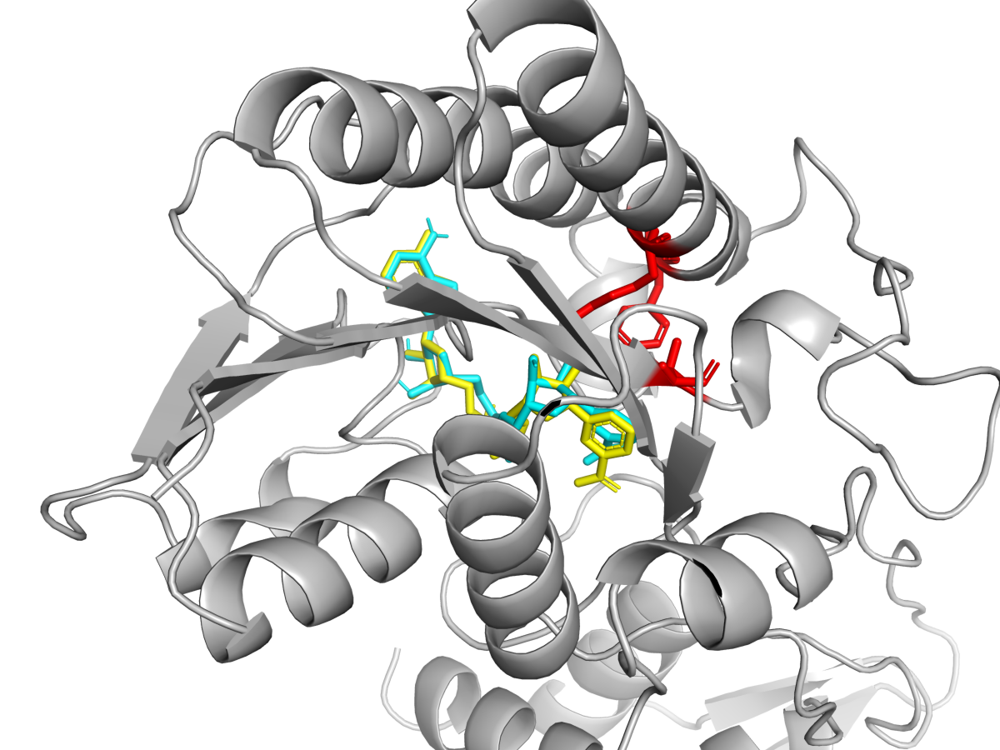
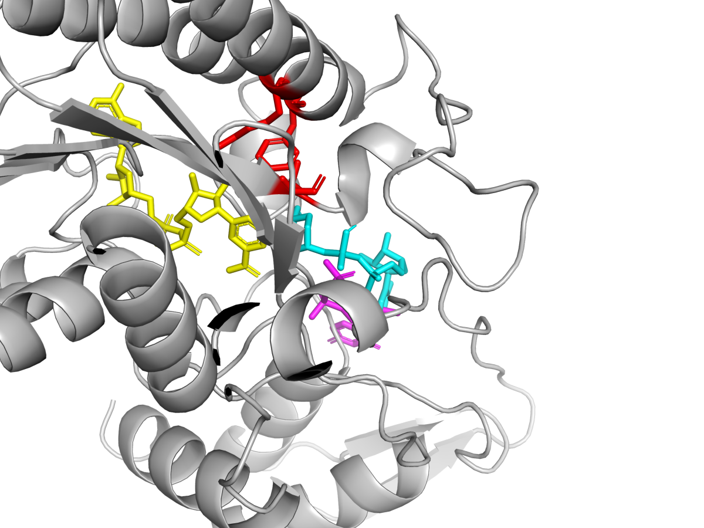

# UXS1 docking, first screening run

Docking of candidate ligands into the UXS1 (UDP-xylose synthase /
UDP-glucuronate decarboxylase 1) active site, as a first computational
screening step after the druggability check in `../docs/druggability-top5.md`.
That check found UXS1 (rank 3 of 20) the most druggable of the top 5 on
structure, with no known inhibitor. This run asks: what binds the active
site in silico, and how strongly does Vina score it?

**This is a prediction, not a measurement.** Docking scores estimate binding
free energy from a scoring function. They do not prove a compound inhibits
UXS1, and they say nothing about cell permeability, selectivity, or
toxicity. Any hit here needs biochemical testing (enzyme inhibition assay)
before it means anything in the lab.

## Method

- **Receptor:** PDB 4GLL, human UDP-xylose synthase, chain A only
  (2423 heavy atoms; the active site sits within one subunit, and all
  residues within 6 A of the co-crystallized NAD are chain A).
  Waters, the co-crystallized NAD, guanidine (GAI) and sulfate (SO4)
  were removed. Prepared with Meeko (`mk_prepare_receptor.py`):
  hydrogens added from residue templates, Gasteiger charges.
  File: `receptor/uxs1_chainA.pdbqt` (2954 atoms incl. hydrogens).
- **Box:** center (53.3, 27.7, 42.3), size 24 x 24 x 24 A. The center is
  the midpoint between the catalytic triad centroid and the
  co-crystallized NAD centroid, so the box covers both the NAD site and
  the UDP-sugar site.
- **Numbering note:** the JBC paper's catalytic triad Thr118/Tyr147/Lys151
  uses the construct numbering (residue 1 = full-length residue 85).
  4GLL uses full-length numbering, so the triad is Thr202/Tyr231/Lys235
  there (offset +84). All three residue types match, and all three sit
  2.7-3.8 A from the co-crystallized NAD, confirming the mapping.
  Triad centroid (4GLL numbering): (57.66, 29.97, 43.73).
  NAD centroid: (48.99, 25.34, 40.83).
- **Docking:** AutoDock Vina 1.2.7, exhaustiveness 16, 9 poses per ligand,
  energy range 3 kcal/mol. Driver script: `run_docking.py`.
  Config: `outputs/vina_config.txt`.
- **Ligands:** 3D structures from PubChem (PUG REST, record_type=3d),
  prepared with Meeko (`mk_prepare_ligand.py`, Gasteiger charges).
  Protonation as drawn by PubChem; phosphate groups modeled protonated
  (see Limits).

## Ligands

| Ligand | PubChem CID | Role | Why picked |
| --- | --- | --- | --- |
| NAD+ | 5892 | Positive control | Natural cofactor; co-crystallized in 4GLL, known to bind |
| UDP | 6031 | Positive control | Product fragment; the UDP moiety of the substrate, known binder |
| UDP-glucuronate | 17473 | Candidate | The natural substrate of UXS1 |
| UDP-xylose | 11857306 | Candidate | The natural product of UXS1 |
| UDP-galactose | 18068 | Candidate | Close analogue of the substrate (epimer at C4 of the sugar) |
| UMP | 6030 | Candidate | Minimal fragment: uridine + one phosphate |

A ChEMBL target search for UXS1 (Nov 15, 2026) returned no target record,
consistent with the druggability check finding no known inhibitor. That is
why the candidates are substrate/product analogues rather than known
inhibitors.

## Results, run 1 (apo receptor, NAD removed)

Best Vina affinity per ligand (kcal/mol; more negative = stronger predicted
binding). Full per-pose energies in `outputs/<ligand>_energies.txt`;
poses in `outputs/<ligand>_out.pdbqt`.

| Rank | Ligand | Role | Best affinity (kcal/mol) |
| --- | --- | --- | --- |
| 1 | NAD+ | Positive control (cofactor) | -12.669 |
| 2 | UDP-xylose | Candidate (natural product) | -10.350 |
| 3 | UDP-glucuronate | Candidate (natural substrate) | -10.266 |
| 4 | UDP-galactose | Candidate (substrate analogue) | -10.003 |
| 5 | UDP | Positive control (product fragment) | -9.185 |
| 6 | UMP | Candidate (minimal fragment) | -8.090 |

### Validation: the NAD re-dock is near-perfect

The docked NAD+ mode 1 reproduces the crystallographic NAD almost exactly:
centroid 0.28 A from the crystal NAD, 42 of 44 heavy atoms (95%) within
2 A of a crystal NAD atom. The setup is sound; the pocket is modeled right.

### The important caveat: the UDP ligands landed in the NAD pocket

All five UDP ligands docked into or overlapping the NAD pocket, not the
crystallographic UDP site. Checked against PDB 2B69 (1.21 A, human UXS1
with NAD+ and UDP bound), aligned onto 4GLL: the substrate-site UDP
(2B69 UDP 900, closest atom 7.67 A from the catalytic triad) sits 13-19 A
from every docked UDP pose, with zero atom overlap. Vina placed each
ligand in the single deepest spot in the box, which is the NAD pocket.
So the run-1 scores say "these molecules can bind the NAD pocket", not
"these molecules bind the substrate site". That is why run 2 (below) was
run with NAD retained in the receptor.

Size note: Vina scores skew more negative for larger ligands (more atoms
make more contacts), so NAD+ leading the table is partly a size effect.
Compare candidates of similar size against each other, and against the
UDP control (-9.185), not against NAD+.

## Results, run 2 (holo receptor, NAD retained)

Same 5 UDP ligands, re-docked with the crystal NAD kept as rigid receptor
atoms and the box re-centered on the substrate site (center 60.0, 23.2,
39.0: midpoint of the 2B69 UDP 900 centroid and the triad centroid).
Driver: `run_docking_holo.py`. Outputs in `outputs/holo/`.

| Rank | Ligand | Role | Best affinity (kcal/mol) | Centroid to crystal UDP 900 (A) |
| --- | --- | --- | --- | --- |
| 1 | UDP-xylose | Candidate (natural product) | -8.796 | 5.66 |
| 2 | UDP | Positive control (product fragment) | -7.480 | 7.38 |
| 3 | UDP-galactose | Candidate (substrate analogue) | -7.391 | 4.92 |
| 4 | UDP-glucuronate | Candidate (natural substrate) | -7.337 | 4.89 |
| 5 | UMP | Candidate (minimal fragment) | -6.997 | 4.69 |

Scores are weaker than in run 1, which is expected: the substrate site is
a shallower, more open cleft than the deep NAD pocket, and the ligands can
no longer fall into the NAD site. UDP-xylose leads the holo run (-8.796)
and has the most atom overlap with the crystal UDP (11 of 34 heavy atoms
within 2 A of a UDP 900 atom). The other four poses sit 4.7-7.4 A from the
crystal UDP centroid with partial overlap (1-7 atoms within 2 A): they are
in the substrate-site region but do not reproduce the crystal UDP pose
exactly. The receptor here is 4GLL's conformation (NAD-bound, no UDP),
while 2B69's is UDP-bound, so some of the difference is induced fit that a
rigid-receptor run cannot capture. Do not over-read the small gaps between
ranks 2-4 (0.14 kcal/mol): that is far inside Vina's error.

Holo receptor construction: `receptor/uxs1_holo.pdbqt` combines the Meeko
apo receptor with the crystal NAD atoms (converted with OpenBabel, then
merged; the NAD atoms keep their crystallographic positions and are rigid
during docking). NAD's adenine carbons are typed aromatic; its
nicotinamide carbons are typed aliphatic C by OpenBabel, a minor typing
quirk. OpenBabel's own whole-protein PDBQT was not used: it writes the
protein as a single flexible molecule with a torsion tree, which is not a
valid rigid receptor for Vina.

## What the numbers do and do not mean

- The two positive controls (NAD+, UDP) are the sanity check: if they do
  not score well and do not land in the crystallographic pocket, the setup
  is wrong and no other number is trustworthy.
- UDP-glucuronate (substrate) and UDP-xylose (product) should both score
  well if the pocket is modeled right; they are the reference for what a
  real binder looks like here.
- A candidate scoring close to the substrate is worth a second look, not a
  conclusion. A candidate scoring far worse than the controls is probably
  not binding this pocket.

## Limits

- Docking scores are predictions from Vina's empirical scoring function,
  not measured binding affinities. Expect errors of roughly 2-3 kcal/mol.
- Rigid receptor: the protein does not move during docking. Real binding
  can involve side-chain and loop rearrangement.
- No explicit solvent, no entropy estimate, no dynamics (no molecular
  dynamics was run). Docking gives static poses, not a trajectory, so
  there is no video to make from this run.
- Ligands were docked in PubChem's as-drawn protonation state. At
  physiological pH the phosphates would be deprotonated; that changes
  hydrogen-bond donor/acceptor assignment and can shift scores.
- Vina's search is stochastic (no fixed seed in the 1.2.7 Python API), so
  repeat runs can differ slightly in pose and score.
- Only chain A was used. UXS1 is a dimer in the crystal; the active site
  is within one subunit, but dimer-interface effects are not modeled.
- No Open Targets tractability score was used here; this run is
  structure-based only.
- The `*_energies.txt` files carry the per-pose affinity (total) plus
  intermolecular and intramolecular energy components from Vina's
  `energies()` call, not RMSD values; the RMSD from the best mode for
  each pose is in the run logs (`docking_run.log`,
  `holo/docking_run_holo.log`). An earlier version of these files
  mislabeled the energy components as RMSD; the headers have been fixed
  and the affinity values were never affected.

## Files

- `receptor/4GLL.pdb`: structure as downloaded from RCSB
- `receptor/2B69.pdb`: 1.21 A structure with NAD+ and UDP bound, used to
  locate the crystallographic UDP site (aligned onto 4GLL, CA RMSD 3.05 A
  over 297 residues; the NAD sites align to ~1.2 A)
- `receptor/uxs1_chainA.pdb`: chain A, heteroatoms/waters removed
- `receptor/uxs1_chainA.pdbqt`: prepared apo receptor for Vina
- `receptor/uxs1_holo.pdbqt`: holo receptor: apo receptor + crystal NAD
  as rigid receptor atoms (run 2)
- `receptor/uxs1_chainA_NAD.pdb`, `receptor/uxs1_chainA_NAD.pdbqt` ,
  OpenBabel conversion used to extract the NAD atoms (not used directly
  as a receptor; see run 2 note)
- `receptor/crystal_NAD_chainA.pdb`: co-crystallized NAD, chain A
- `receptor/crystal_UDP900_in4GLL.pdb`: 2B69 UDP 900 transformed into
  the 4GLL frame (substrate-site reference)
- `receptor/2B69_UDP_900_in4GLL.npy`, `receptor/2B69_UDP_901_in4GLL.npy`,
  `receptor/2B69_NAD_800_in4GLL.npy`, transformed coordinates (numpy)
- `receptor/uxs1_box.txt`, `receptor/uxs1_chainA.box.pdb`: box definition
- `ligands/<name>.sdf`: 3D structures from PubChem
- `ligands/<name>.pdbqt`: prepared ligands for Vina
- `outputs/<ligand>_out.pdbqt`: docked poses, run 1 (9 per ligand)
- `outputs/<ligand>_energies.txt`: per-pose energies, run 1
- `outputs/results.csv`: best affinity per ligand, run 1, ranked
- `outputs/vina_config.txt`: run 1 parameters
- `outputs/docking_run.log`: full Vina log, run 1
- `outputs/NAD_best_pose.png`: PyMOL render: docked NAD vs crystal NAD
- `outputs/holo/<ligand>_out.pdbqt`: docked poses, run 2 (9 per ligand)
- `outputs/holo/<ligand>_energies.txt`: per-pose energies, run 2
- `outputs/holo/results_holo.csv`: best affinity per ligand, run 2, ranked
- `outputs/holo/docking_run_holo.log`: full Vina log, run 2
- `outputs/holo/UDP-xylose_best_pose_holo.png`: PyMOL render: best holo pose
- `run_docking.py`: driver script, run 1 (re-runnable)
- `run_docking_holo.py`: driver script, run 2 (re-runnable)
- `check_pose.py`: pose-vs-crystal-NAD comparison script
- `render_pose.py`, `render_pose_holo.py`: PyMOL render scripts

## Environment

Linux VM, Python 3.12, AutoDock Vina 1.2.7, Meeko, RDKit, OpenBabel
(installed via pip into a venv at /tmp/docking-venv/venv; the venv is
ephemeral, the scripts and configs above are enough to reproduce the run).
PyMOL 2.5.0 (apt) for rendering; it needs a small `imp` shim on Python
3.12 (`/tmp/imp_shim/imp.py`, `PYTHONPATH=/tmp/imp_shim`) because PyMOL
2.5 imports the removed `imp` module. Run Nov 15-16, 2026.
