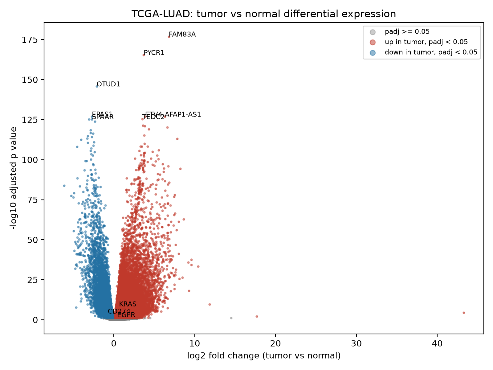
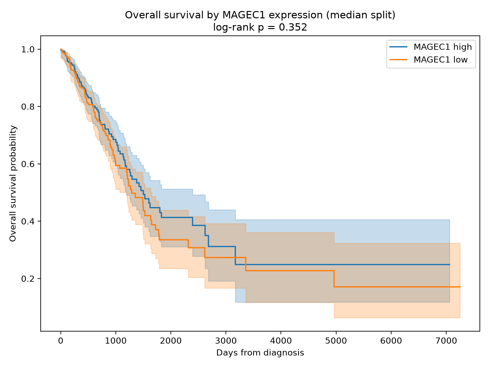
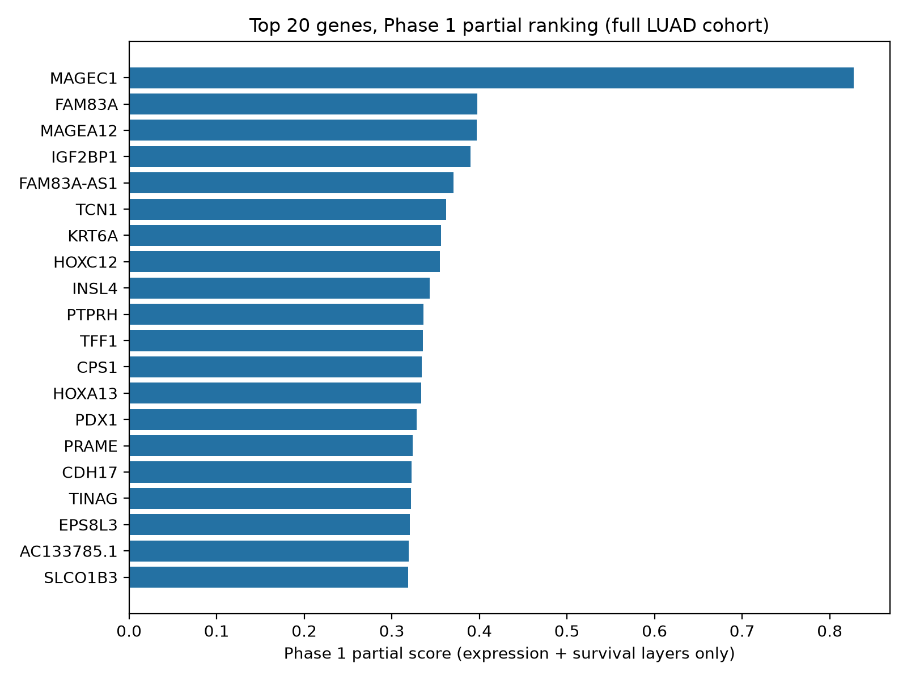

# Phase 1 report: a first gene ranking for lung adenocarcinoma

**In one sentence:** we ran the first real analysis for OncoTarget Scout on public lung cancer data from 528 tumors and 59 healthy lung samples, ranked 35,273 genes with the first two of our five evidence layers, and then graded the ranking against three genes we know matter. The famous genes did fine, not great, and the number one hit turned out to be a mirage. Both of those results are useful, and this report explains why.

## Correction, 2026-11-12 (Phase 2 shrinkage fix)

The results below are the original Phase 1 v1 run, kept intact. During
Phase 2 we fixed the fold change problem this report discloses: the
tumor vs normal fold changes were re-estimated with apeglm shrinkage
(pydeseq2 `lfc_shrink`, Cauchy prior; p values unchanged), and the
Phase 1 partial ranking was rebuilt from the shrunk values. The
rebuilt table is `results/tables/target_scores_phase1_shrunk.csv`.

What changed:

- MAGEC1's log2 fold change fell from 43.28 to 8.20, and MAGEC1 fell
  from rank 1 to rank 145 of 35,273. The artifact is gone. The new
  rank 1 is PSG1 (shrunk log2 fold change 12.68, the new scale
  maximum), followed by GAGE2A and DEFA5. The maximum |log2 fold
  change| in the whole table is now 12.68, and the count of
  significant genes is unchanged at 25,893, as it should be, since
  shrinkage does not touch p values.
- The answer key ranks got worse, and that is the honest part of this
  correction. In the shrunk rebuild, KRAS ranks 2,633rd, EGFR 5,263rd,
  and CD274 8,364th, against 155th, 282nd, and 457th in v1. The v1
  ranks were partly flattered by the artifact: with MAGEC1's 43.28
  stretching the scale, every other gene's expression score was
  compressed (FAM83A's 6.79 became 0.157), which let the three answer
  key genes' second layer, survival, lift them above most
  expression-only genes. With an honest scale, expression-only genes
  score up to 1.0 on their own layer, and the answer key genes' small
  fold changes place them mid-pack. An expression-first score cannot
  crown mutation-driven genes. That conclusion, already stated in v1,
  is stronger in v2, and it is the reason Phase 2 adds the dependency
  layer rather than tuning the expression score.

Nothing else in this report changes. The pathway results, the survival
models, and the MAGEC1 Kaplan-Meier figure are unaffected by the
shrinkage fix.

## The question

Some lung cancers carry mutations in two genes, STK11 and KEAP1. Those tumors tend to ignore immunotherapy, respond poorly to other treatments too, and no approved drug targets the mutation itself. This project asks: which genes should a drug aim at for these patients?

Phase 1 is deliberately simpler than the full question. Before trusting any method on the small STK11/KEAP1 subgroup, we test it on the full lung adenocarcinoma cohort, where the data is plentiful and some answers are already known. If the method cannot find known biology in the easy case, it has no business judging the hard case.

## What we ran, in plain language

The data comes from TCGA, a public project that measured gene activity in hundreds of lung tumors and in healthy lung tissue from the same population. We downloaded the data from the UCSC Xena GDC hub, which republishes the same GDC measurements.

Three analyses, each answering one question:

1. **Differential expression:** which genes are more active, or less active, in tumors than in healthy lung? We used DESeq2 (through its Python port, pydeseq2), the standard method for this. A gene with a log2 fold change of 3 is about 8 times more active in tumors.
2. **Pathway analysis (GSEA):** do the winning genes cluster into known biological programs, for example cell division or inflammation? We tested the 50 Hallmark pathway sets from MSigDB.
3. **Survival link:** for the top 300 candidate genes, is higher activity linked to patients living shorter lives, after accounting for cancer stage and age? This used Cox models in 485 patients with complete records, of whom 177 died during follow-up.

The ranking then combines layers 1 and 3 into a partial score. It is labeled partial everywhere because the full design has five layers. The other three (does the cancer actually need the gene, tested with CRISPR data; is the gene active in the cancer cells themselves, from single cell data; is it quiet in vital healthy organs) arrive in Phases 2 and 3.

## What we found

**Tumors rewire a lot.** Of 35,273 genes tested, 25,893 were significantly different between tumor and healthy lung at an adjusted p value under 0.05: 18,894 more active in tumors and 6,999 less active. The single most significant change was FAM83A, about 110 times more active in tumors (log2 fold change 6.79, adjusted p value 1.3e-177). A family of genes that is normally only switched on in testes, the MAGE family (MAGEA3, MAGEA6, MAGEA12), was also switched on in tumors, a pattern cancer biologists recognize. Going the other way, AGER, a marker of healthy lung lining cells, dropped sharply (log2 fold change -5.02), which is what you expect when healthy lung cells are replaced by tumor.

**The pathway picture is a story of division up, inflammation down.** 36 of the 50 Hallmark pathway sets were significant. The strongest positive signals were all about growth: E2F Targets (normalized enrichment score 3.20), G2-M Checkpoint (2.95), Myc Targets V1 (2.60), and Glycolysis (2.54). The strongest negative signals were immune and inflammation programs: TNF-alpha Signaling via NF-kB (-3.19) and Inflammatory Response (-2.66). That second part surprised us, and we think it is a data trap worth naming: a healthy lung sample is full of resident immune cells, so a piece of healthy lung can look more "inflammatory" than a tumor sample that is mostly cancer cells. Bulk data mixes cell types together, and this is exactly the confusion the single cell layer in Phase 3 is designed to resolve.

**The answer key check: respectable, not triumphant.** Before running anything, we committed to checking where three known lung cancer genes land in the ranking: EGFR, KRAS, and CD274 (the gene that makes PD-L1, the immunotherapy target). Out of 35,273 genes, they ranked:

- KRAS: number 155
- EGFR: number 282
- CD274: number 457

All three sit within the top 1.3 percent of the ranking, and none sits anywhere near the very top. The honest reason is visible in their numbers. Their expression changes are small: KRAS is only modestly more active in tumors (log2 fold change 0.65), EGFR less so (0.41), and CD274 is actually less active in tumors on average (-0.74). These genes matter in lung cancer mainly through mutations and protein behavior, not through big swings in how much of them is made. A ranking built on expression alone will never crown them, which is a real limitation of this Phase 1 score, stated now rather than discovered later. One genuine positive: KRAS did earn part of its rank from the survival layer. In the adjusted Cox model, higher KRAS expression was linked to worse survival (hazard ratio 1.21 per standard deviation, p = 0.0096), in 485 patients.

A technical caution belongs here too. The survival layer was computed for 303 genes (the top 300 candidates plus the three answer key genes), and the score adjusts for how many layers each gene has. So the answer key ranks mix both layers, while most genes in the table were scored on expression alone. Read within the both-layers group, the answer key genes are mid-pack, and their expression-only ranks are far lower (KRAS 13,917th, EGFR 16,616th, CD274 29,771st on expression alone). The Phase 1 ranking is a working draft, not a verdict.

**The number one gene is a warning, and it is our favorite result.** Rank 1 is MAGEC1, a cancer-testis gene that is nearly silent in healthy lung and switched on in some tumors. Its fold change computes to an absurd 43 on the log2 scale, an artifact of dividing by almost zero, and that one number also stretches the scale every other gene is measured against. Meanwhile its survival evidence is empty: a Cox hazard ratio of 1.02 (p = 0.84), and splitting patients by MAGEC1 expression produces two survival curves that lie on top of each other. This is precisely the failure mode this project was designed against. Expression alone promotes loud genes. The CRISPR dependency layer in Phase 2 asks the harder question, does the cancer cell die without this gene, and it exists to remove hits like this one.

**Some names further down look more serious.** FAM83A ranks 2nd overall, pairs the strongest statistical signal in the whole dataset with a real survival link (hazard ratio 1.39 per standard deviation, p = 0.0002). IGF2BP1 ranks 4th with a similar pattern (hazard ratio 1.38, p = 0.000001). These are candidates in the proper sense: interesting enough to test with the remaining layers, nowhere near proven.

## Honest limits

- This run used a Python route (Xena GDC hub data, pydeseq2, gseapy, lifelines) in place of the R route in the original design (TCGAbiolinks and DESeq2 in R). The Xena count file stores log-transformed values, and integer counts were recovered by reversing that transform. Every substitution is recorded in results/run_log.md.
- Fold changes are unshrunken, which is how the MAGEC1 artifact above happened. It is disclosed rather than quietly fixed, because changing the method after seeing the result would break the pre-committed design. Any shrinkage change belongs to a labeled v2.
- Bulk tumor data mixes cancer cells with immune and structural cells. Pathway and expression signals carry that confusion, as the inflammation result shows.
- TCGA is retrospective, mostly one population mix, and its survival data reflects older treatment eras. Everything here is a hypothesis generator, not a clinical claim.
- Phase 1 covers the full lung adenocarcinoma cohort. It says nothing yet about the STK11/KEAP1 subgroup itself.
- Two items from the original Phase 1 spec were deferred: the Reactome pathway collection (Hallmark was run) and a PCA figure.

## What Phase 2 adds

Phase 2 turns to the actual subgroup: differential expression between STK11/KEAP1-mutant tumors and wild type tumors of the same cancer, the DepMap CRISPR dependency layer that tests whether mutant lung cancer cells need each candidate gene, and the GTEx safety layer that checks whether a candidate is quiet in the heart, brain, and liver. Expect the ranking to change substantially. If MAGEC1 survives the dependency layer, that will be interesting. If it does not, the system worked as designed.
