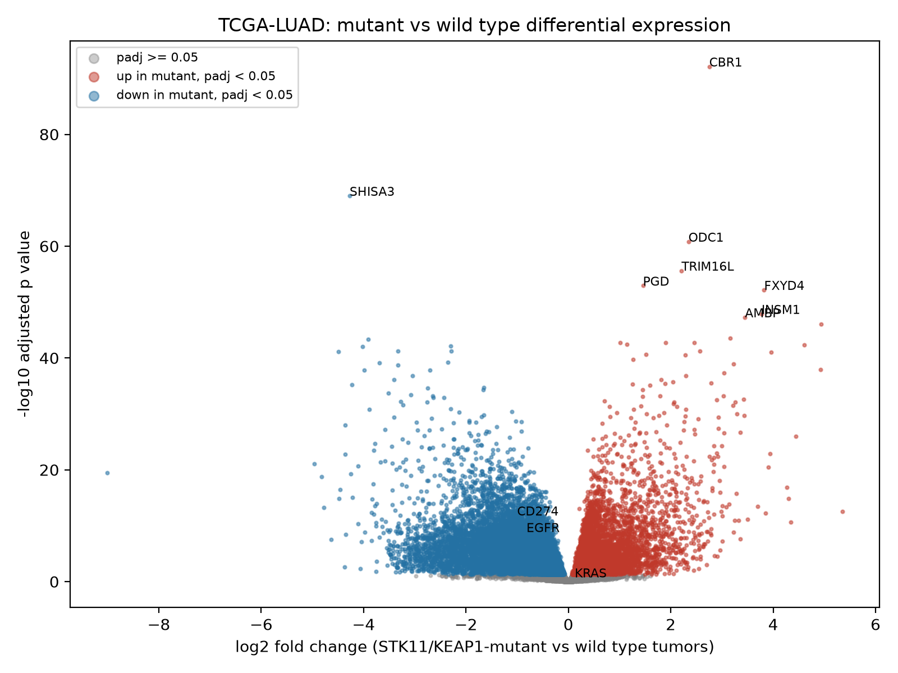
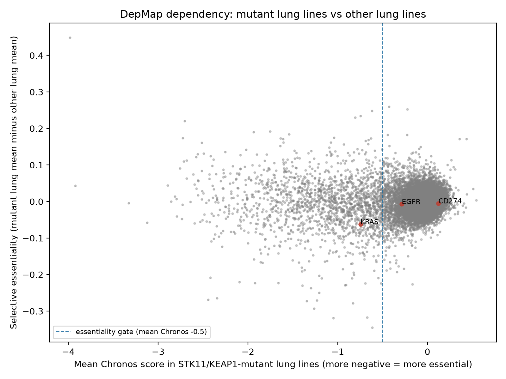
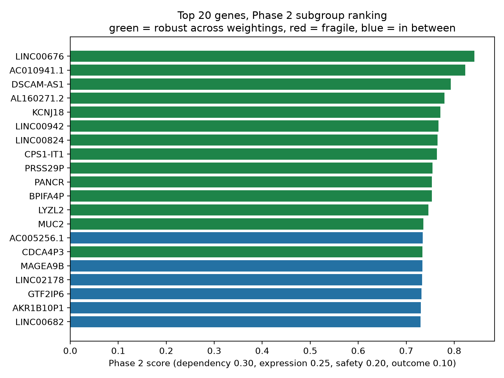
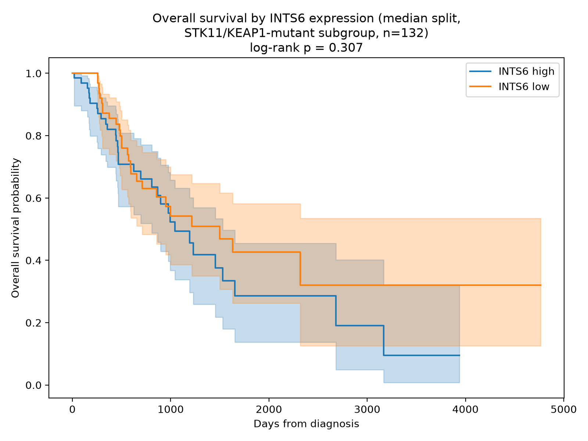

# Phase 2 report: the subgroup ranking, with dependency evidence

**In one sentence:** we fixed the fold change artifact from Phase 1, split the lung tumors by STK11/KEAP1 mutation status, added CRISPR dependency data from 40 mutant lung cancer cell lines and a safety check from healthy organ data, and rebuilt the ranking for the subgroup itself. The headline shortlist is led by INTS6 and NFE2L2, the gene that encodes NRF2, which is exactly the biology KEAP1 loss creates. The known lung cancer genes rank low, and the report explains why that is the correct behavior for a subgroup ranking rather than a failure of it.

## The question, now asked properly

Phase 1 tested the method on all lung adenocarcinoma. Phase 2 asks the real question: for the STK11/KEAP1-mutant subgroup, the patients immunotherapy leaves behind, which genes should a drug aim at? Three new pieces of evidence join the ranking: whether mutant tumors express a gene more than wild type tumors of the same cancer, whether mutant cancer cells die without the gene (CRISPR data), and whether the gene is quiet in the heart, brain, and liver (safety data).

## What we ran, in plain language

**The shrinkage fix.** Phase 1's fold changes were unshrunken, which let MAGEC1 reach a log2 fold change of 43.28 by dividing by an almost-zero normal baseline. We re-ran the tumor vs normal analysis with apeglm shrinkage, which pulls low-information fold changes toward zero without touching p values. MAGEC1's fold change fell to 8.20 and its rank in the rebuilt Phase 1 ranking fell from 1 to 145 of 35,273. The new rank 1 is PSG1 (shrunk fold change 12.68). The full correction, including the fact that the answer key ranks got honestly worse in the shrunk rebuild, is recorded as a dated note at the top of the Phase 1 report.

**The subgroup split.** Using mutation records for STK11 and KEAP1, the 528 primary tumors split into 379 wild type, 48 STK11-only, 70 KEAP1-only, and 25 with both mutations. Six tumors had no mutation data and were left out of the subgroup analysis. The combined mutant group is 143 tumors against 379 wild type.

**Mutant vs wild type expression.** Within tumors only, 19,922 of 34,835 genes differ significantly between mutant and wild type tumors: 7,222 more active in mutants, 12,700 less active. The largest increases are PCSK2, CGA, and CALCA, all around 4.4 to 4.9 on the log2 scale, plus two non-coding RNAs. The most statistically significant increase is CBR1 (fold change 2.75, adjusted p value 7.4e-93), followed by the metabolism genes ODC1 and PGD. Two results deserve attention. First, CD274, the gene that makes PD-L1, is significantly *lower* in mutant tumors (fold change -1.00, adjusted p value 1.5e-12), and EGFR is lower too (-0.82, 1.4e-09). That matches the known biology: these tumors are immunologically cold and express little PD-L1. The data reproduces the clinical picture without being told to. Second, NFE2L2, the gene for NRF2, is barely changed in expression (-0.20). That matters for what comes next, because NRF2 is controlled at the protein level by KEAP1, not at the RNA level. Expression data alone cannot see it.

**The dependency layer.** From DepMap Public 24Q4, 67 lung cancer cell lines carry STK11 and/or KEAP1 mutations (19 carry both), and 40 of them have CRISPR knockout data, against 86 other lung lines with CRISPR data. For each gene we computed selective essentiality: how much more the mutant lines need the gene than other lung lines do. The top hit is NFE2L2 itself (selective essentiality -0.345, mean Chronos -0.615 in mutant lines against -0.270 in other lung lines). This is the pipeline rediscovering the pathway's central biology on its own: KEAP1 loss frees NRF2, the mutant cells rewire around NRF2-driven programs, and knocking NRF2 out hurts them more than it hurts other lung cells. The next hits are INTS6 (-0.319), UXS1 (-0.318, an enzyme in sugar metabolism, a plausible metabolic dependency in this subgroup), ATP1A1 (-0.293), and ARF4 (-0.279).

**The safety layer.** From GTEx v8 median expression, each gene got a safety window from its expression in heart, brain, and liver: quiet in all three scores near 1. Most genes are quiet in these organs (median safety window 0.979), so this layer mainly penalizes the loud minority rather than ranking the quiet majority. NFE2L2 scores 0.653 here, middling, because NRF2 is active in normal tissues too. That is a real flag on the top dependency hit, and it is in the table for anyone to see.

**Survival, in the subgroup this time.** The outcome layer was recomputed for 503 genes (the top 500 of a preliminary ranking plus the three answer key genes) using Cox models in the 132 mutant subgroup patients with complete records, of whom 59 died during follow-up. Only 52 of the 503 models reached p under 0.05. The survival evidence in this subgroup is thin, which is why it carries the lowest weight in the score.

## The ranking, and the coverage problem it exposed

The Phase 2 ranking scores 28,328 genes across four layers (dependency 0.30, expression 0.25, safety 0.20, outcome 0.10), renormalized over the layers each gene actually has. A further 6,945 genes were excluded as unscoreable: no DepMap coverage and no expression signal.

The overall top 20 is not the shortlist, and understanding why is the most important part of this report. All 20 are non-coding RNAs, pseudogenes, or genes with no DepMap coverage at all (LINC00676 is number 1). They score high on expression, safety, and outcome, and because the dependency layer is missing for them, its weight simply drops out of their denominator. Renormalization, done exactly as the design specifies, systematically favors genes that are missing the highest-weighted layer. The design anticipated this: the spec says genes are compared within the same coverage where a decision depends on it, and the README's dependency check requires top candidates to be supported by CRISPR evidence. So the decision shortlist below is drawn from the 848 genes with actual dependency support, and the overall top 20 is reported as what it is: an expression-led list, not a target list.

## The shortlist: 20 dependency-supported candidates

| Shortlist rank | Gene | Overall rank | Score | Dependency | Safety | Notes |
| --- | --- | --- | --- | --- | --- | --- |
| 1 | INTS6 | 174 | 0.642 | 0.924 | 0.877 | Robust |
| 2 | NFE2L2 | 307 | 0.618 | 1.000 | 0.653 | Robust |
| 3 | SPRR1B | 317 | 0.616 | 0.582 | 0.963 | Robust |
| 4 | UXS1 | 450 | 0.599 | 0.921 | 0.722 | Robust |
| 5 | NCAPG2 | 460 | 0.597 | 0.725 | 0.861 | Robust |
| 6 | ADSL | 485 | 0.573 | 0.785 | 0.777 | Robust |
| 7 | GMPS | 651 | 0.519 | 0.789 | 0.731 | Robust |
| 8 | ARF4 | 1369 | 0.492 | 0.808 | 0.612 | |
| 9 | SGO1 | 1615 | 0.486 | 0.426 | 0.990 | Robust |
| 10 | SLC33A1 | 1779 | 0.482 | 0.650 | 0.793 | Robust |
| 11 | ICE2 | 1911 | 0.480 | 0.649 | 0.812 | Robust |
| 12 | CENPA | 1934 | 0.479 | 0.394 | 0.979 | Robust |
| 13 | CDK4 | 2615 | 0.464 | 0.664 | 0.700 | |
| 14 | CDAN1 | 2867 | 0.460 | 0.663 | 0.716 | |
| 15 | SKA1 | 2885 | 0.459 | 0.410 | 0.921 | Robust |
| 16 | ATP1A1 | 2925 | 0.459 | 0.849 | 0.447 | Fragile |
| 17 | MED30 | 3192 | 0.453 | 0.639 | 0.742 | |
| 18 | COPG1 | 3221 | 0.453 | 0.688 | 0.610 | Fragile |
| 19 | KIF4A | 3234 | 0.452 | 0.367 | 0.959 | Robust |
| 20 | RPL6 | 3286 | 0.451 | 0.779 | 0.467 | Fragile |

Robust means the gene stays in the shortlist top 20 under all three weightings (main, equal, expression-first); fragile means it appears under exactly one. Thirteen of the 20 are robust. Note what the top of this list looks like: INTS6 and NFE2L2 have zero expression signal (tumor specificity 0.000) and rank purely on dependency plus safety plus survival. That is the design working as intended. A project that stopped at differential expression would never have found either of them. Note also the caveats in the same table: ATP1A1 and RPL6 carry the lowest safety scores on the list (0.447 and 0.467), and they are flagged fragile as well. The full table with every layer value is in `results/tables/shortlist_dependency_supported.csv`.

The top shortlist gene, INTS6, has no survival signal at all: its subgroup Cox hazard ratio is 1.00 (p = 0.974) and its Kaplan-Meier curves overlap (log-rank p = 0.307). Its rank comes from dependency and safety, not from outcomes. That is acceptable under the design, where survival is supporting evidence only, but it means INTS6 is a dependency hypothesis, not a prognosis story, and the report should not dress it up as one.

## The answer key check: low ranks, correct behavior

In the Phase 2 ranking of 28,328 genes, the three answer key genes land at KRAS 4,993rd, CD274 5,646th, and EGFR 6,166th. All three are mid-pack, far below their Phase 1 full-cohort ranks. This is reported untuned, and it needs the right interpretation, because the check means something different in Phase 2 than it did in Phase 1.

Phase 1 asked whether the method recovers known lung cancer biology in the full cohort. Phase 2 asks whether those known genes are *subgroup-selective* targets. The data says no: EGFR and CD274 are expressed less in mutant tumors than in wild type tumors, none of the three is selectively essential in mutant cell lines (selective essentiality -0.007, -0.005, and -0.062), and their survival links in the subgroup are weak (hazard ratios 1.10, 1.08, and 1.23, none significant). That is consistent with the clinical facts the project started from: EGFR inhibitors and PD-L1 blockade work poorly in STK11/KEAP1-mutant tumors. A subgroup ranking that crowned CD274 would be contradicting its own data. The check did not fail; it answered a different question than the one it was written for, and the answer is informative. The full v2 check is in `results/answer_key_check.md`.

Two Phase 1 names fall with the same logic. FAM83A, the strongest Phase 1 signal, ranks 4,689th here: it is a general lung cancer signal, not a subgroup dependency (dependency 0.000). MAGEC1 ranks 4,712th, also with no dependency support. The dependency layer did what it was designed to do to both of them.

## Sensitivity analysis

The ranking was rebuilt under equal weights and under expression-first weights. The overall rankings correlate strongly (Spearman 0.994 against equal weights, 0.986 against expression-first), and 14 of the overall top 20 stay in the top 20 under all three weightings. Within the dependency-supported shortlist, 13 of 20 are robust and 3 are fragile (ATP1A1, COPG1, RPL6). The shortlist is not an artifact of one weighting choice, though the bottom of it moves around, which is why the fragile labels exist.

## Honest limits

- The dependency layer rests on 40 mutant lung lines with CRISPR data. That is enough to rank, and the NFE2L2 result shows it carries real signal, but a dependency claim backed by 40 lines is weaker than one backed by 400, and every dependency value in the tables carries its line counts.
- The mutant subgroup survival cohort is small (132 patients, 59 deaths). Only 52 of 503 Cox models reached significance, and the outcome layer's 0 to 1 scaling is stretched by one extreme outlier (a pseudogene, RN7SL564P, with a log hazard ratio of -7.42 and p = 0.076), so a gene with no survival effect at all can show an outcome value near 0.93. Read the absolute hazard ratios and p values in `results/tables/cox_phase2.csv`, not just the scaled layer. The outcome layer's weight is 0.10, which bounds the damage, and a future version should clip or winsorize the scale.
- The overall ranking's top 20 is non-coding genes without dependency coverage, for the renormalization reason explained above. The shortlist, not the overall top 20, is the decision output. A future version should consider requiring dependency coverage for the headline ranking, or reporting the ranking stratified by coverage.
- The per-gene subgroup tables (STK11-only, KEAP1-only, both vs wild type) contain a handful of extreme unshrunk fold changes from low-count genes in small groups (for example PSG5 at 79.2 in the KEAP1-only table, adjusted p value 0.86). Those tables are supporting analyses; the ranking uses only the combined mutant vs wild type table, whose maximum |log2 fold change| is 9.01.
- The safety layer uses GTEx median expression in heart, brain, and liver only. The Human Cell Atlas normal lung component from the original design is still missing, and the safety window is a coarse proxy for real toxicity.
- The single cell layer is still missing, so nothing here says whether a candidate is active in the malignant cells themselves or in the surrounding tissue. That is Phase 3.
- The optional druggability flag was skipped: the DGIdb monthly download URLs now return the site's web page instead of the data files, so no clean public source was available in this run.
- Data substitutions, logged in full in `results/run_log.md`: mutation calls come from the cBioPortal API because the Xena mutation files return HTTP 403; DepMap 24Q4 comes from the Broad's figshare deposit because the portal download API returns a human-verification page to scripts; the whole pipeline runs in Python (pydeseq2) rather than R.

## What Phase 3 adds

Phase 3 adds the single cell layer (which cells express each candidate), the time split check (would the method have found KRAS G12C targets before 2021), one reason card per top gene, and the validation experiment plan: the specific STK11/KEAP1-mutant cell lines to test INTS6, NFE2L2, and UXS1 in, the perturbation, and the result that would confirm or kill each candidate. The shortlist above is the input to that plan.
