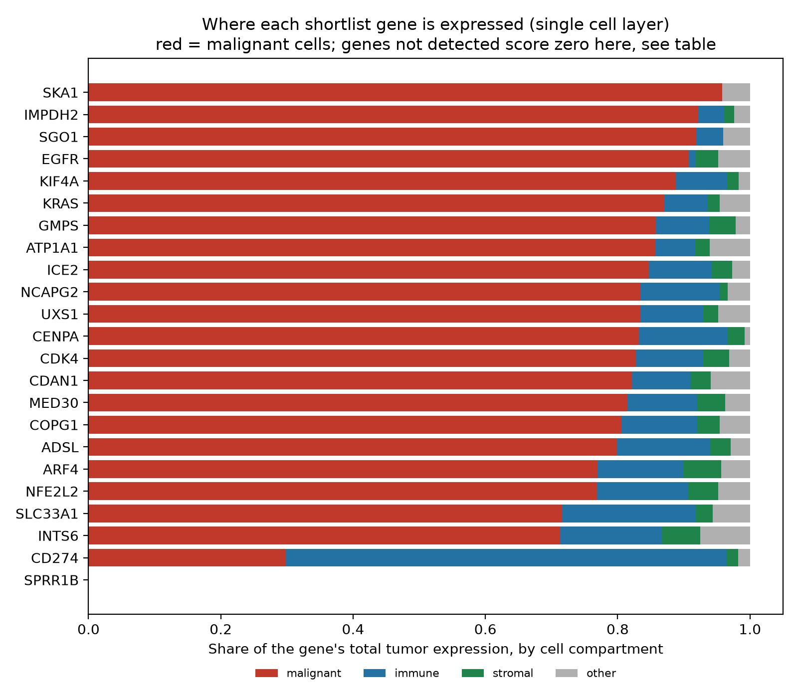
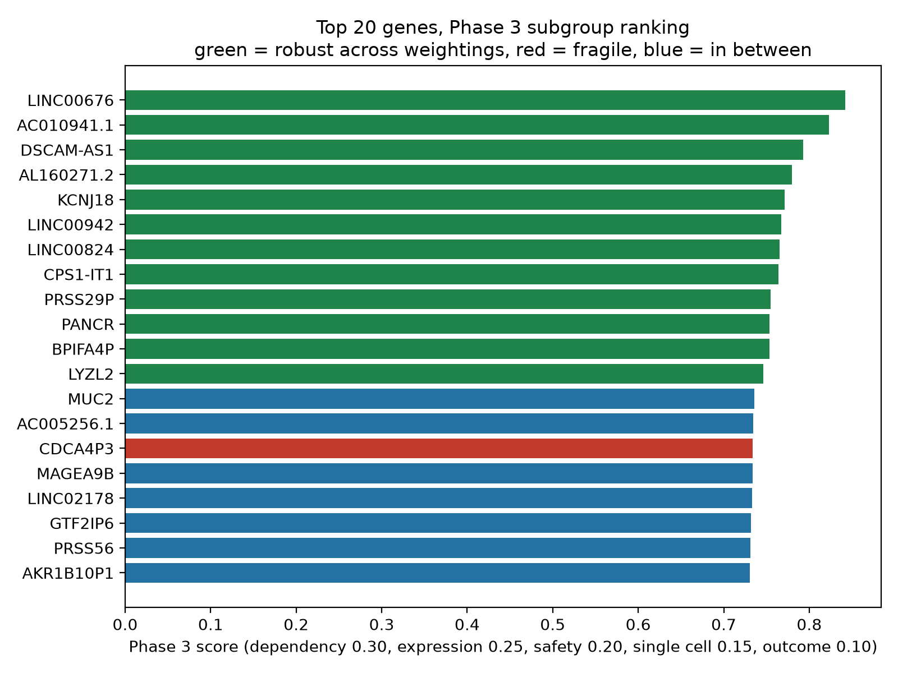
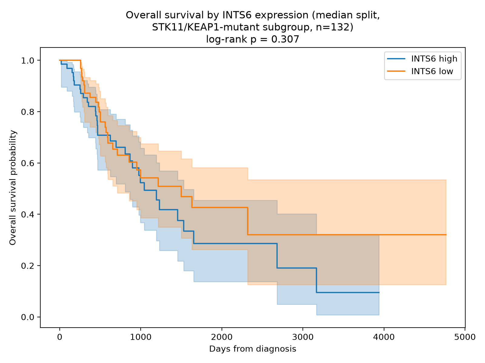

# Phase 3 report: the fifth layer, the time split, and the experiment plan

**In one sentence:** we added the single cell layer from CELLxGENE, which confirms that 19 of the 20 shortlist genes are active in the malignant cells themselves, rebuilt the ranking across all five layers (IMPDH2 enters, RPL6 leaves), ran the pre-committed time split check against DepMap 20Q2 (the top biology survives, SPRR1B does not), and wrote the validation plan naming the exact mutant cell lines to test the top five genes in. The shortlist is stable where it matters and the report says plainly where it is not.

## What Phase 3 adds

Phase 2 ranked the STK11/KEAP1-mutant subgroup across four layers and produced a 20-gene shortlist led by INTS6 and NFE2L2. It left four things open, and Phase 3 does all four: the single cell layer (which cells express each candidate), the time split check (would the method have found this biology before 2021), one reason card per shortlist gene, and the validation experiment plan. Nothing in Phase 2 was re-tuned to make Phase 3 look better. The weights, the gates, and the rules are the ones the spec set before any ranking ran.

## The single cell layer

**The dataset.** From CELLxGENE we used dataset 4ca422ae-e4ad-4884-9073-7c3799cd9143, a Chromium 10x study of archived lung tumor tissue (bioRxiv 2024.11.01.621259), chosen because its author cell type labels include an explicit malignant cell compartment. It holds 35,954 cells. The disease split is lopsided: 33,396 cells are squamous cell carcinoma and only 2,558 are lung adenocarcinoma. The layer uses the LUAD cells only, identified by the per-cell disease label, because this project is about adenocarcinoma. After light quality control (total counts at least 500, genes detected at least 200), 1,953 LUAD cells remain: 756 malignant, 953 immune, 152 stromal, 92 other. Those cells come from two donors (1,352 and 601 cells). Two donors is thin, and it is the main limit on this layer. The full label to compartment mapping is in `results/tables/singlecell_compartments.csv` and the quality control summary in `results/tables/singlecell_qc.json`.

**What the layer measures.** For each gene, the malignant share is the fraction of that gene's total counts across the LUAD tumor cells that come from malignant cells, with immune, stromal, and other shares computed the same way. Counts were summed from the raw count matrix, not from log values, and author labels were used as given, with no re-clustering. Genes with fewer than 20 total counts in the dataset get no share (4,603 genes across the dataset). Of the 16,392 genes in the ranking universe that appear in the dataset, 13,115 have a defined malignant share and 3,277 were not detected at all.

**What it says about the shortlist.** The 19 detected shortlist genes have malignant shares from 0.713 (INTS6) to 0.958 (SKA1), median 0.832. Expressed as the share of malignant cells with any detectable transcript: INTS6 27.6 percent, NFE2L2 39.4 percent, UXS1 31.6 percent, NCAPG2 28.7 percent, IMPDH2 30.8 percent. The one exception is SPRR1B, which has zero counts in every compartment of the LUAD subset: not detected at all, so its tumor location is unconfirmed rather than refuted. A gene can be a real dependency and still be undetectable in a small single cell dataset, especially a lowly expressed one, but the honest statement is that SPRR1B carries no single cell evidence.

**The background problem, stated plainly.** The median malignant share across all 13,115 genes with a defined share is 0.786, and 73.8 percent of genes have a share above 0.7. Malignant cells are 39 percent of the cells used but contribute most of the counts, because tumor cells are transcriptionally more active. So a malignant share of 0.8 is not, by itself, strong evidence that a gene is tumor specific; it is close to background. The layer's real discriminating power is at the low end: it correctly identifies genes that live in the immune or stromal compartment. CD274 (PD-L1) has a malignant share of 0.298 and an immune share of 0.667, expressed in 2.0 percent of malignant cells, and its rank falls from 5,646th to 9,694th when the layer is added. That is the layer working as designed. The shortlist's high shares are consistent with tumor location but should not be oversold, and the report does not oversell them. One technical note: the raw malignant shares already span the full 0 to 1 range (25 genes at 0, 51 at 1), so the min-max scaled layer value equals the raw share for every gene.

## The five-layer ranking

The Phase 3 ranking scores 28,328 genes across all five layers with the spec weights: dependency 0.30, expression 0.25, safety 0.20, malignant cell share 0.15, outcome 0.10, renormalized over the layers each gene actually has. The same 6,945 genes are excluded as unscoreable as in Phase 2. The overall top 20 is again non-coding RNAs and genes without dependency coverage (LINC00676 is number 1, as in Phase 2), for the renormalization reason explained in the Phase 2 report. The shortlist, not the overall top 20, remains the decision output.

The survival layer was re-selected the same way as in Phase 2: the top 500 of a preliminary five-layer ranking plus the three answer key genes. That re-selection pulled in 34 genes that were not in the Phase 2 Cox set, and their Cox models were run fresh in the 132-patient mutant subgroup; the other 469 values were reused unchanged. Six of the 34 new models reached p under 0.05, including four shortlist genes that had no outcome layer value at all in Phase 2: ARF4 (hazard ratio 1.46, p = 0.004), SGO1 (1.50, p = 0.004), SKA1 (1.42, p = 0.008), and GMPS (1.37, p = 0.016). In total 58 of 537 Cox models now reach p under 0.05, against 52 of 503 in Phase 2. The full set is in `results/tables/cox_phase3.csv`.

That matters for reading the rank changes below, because the v2 to v3 movement has two causes, not one. The single cell layer is the new evidence, but the Cox re-selection also gave several genes an outcome layer value they previously lacked. ARF4 (overall rank 1,369 to 483), SGO1 (1,615 to 451), and SKA1 (2,885 to 477) rose on both. INTS6 (174 to 144), NFE2L2 (307 to 192), and UXS1 (450 to 216) rose mostly on the single cell layer, since their Cox values were already in the Phase 2 set.

## The shortlist, version 3

| Shortlist rank | Gene | Overall rank | Score | Dependency | Malignant share | Safety | Notes |
| --- | --- | --- | --- | --- | --- | --- | --- |
| 1 | INTS6 | 144 | 0.652 | 0.924 | 0.713 | 0.877 | Robust |
| 2 | NFE2L2 | 192 | 0.640 | 1.000 | 0.769 | 0.653 | Robust |
| 3 | UXS1 | 216 | 0.634 | 0.921 | 0.834 | 0.722 | Robust |
| 4 | NCAPG2 | 229 | 0.633 | 0.725 | 0.834 | 0.861 | Robust |
| 5 | SPRR1B | 331 | 0.616 | 0.582 | not detected | 0.963 | Robust |
| 6 | GMPS | 338 | 0.615 | 0.789 | 0.857 | 0.731 | Robust |
| 7 | ADSL | 407 | 0.607 | 0.785 | 0.799 | 0.777 | Robust |
| 8 | SGO1 | 451 | 0.600 | 0.426 | 0.919 | 0.990 | Robust |
| 9 | SKA1 | 477 | 0.586 | 0.410 | 0.958 | 0.921 | Robust |
| 10 | ARF4 | 483 | 0.582 | 0.808 | 0.770 | 0.612 | Robust |
| 11 | ICE2 | 484 | 0.580 | 0.649 | 0.847 | 0.812 | Robust |
| 12 | CENPA | 485 | 0.579 | 0.394 | 0.832 | 0.979 | Robust |
| 13 | ATP1A1 | 609 | 0.525 | 0.849 | 0.857 | 0.447 | Fragile |
| 14 | KIF4A | 613 | 0.525 | 0.367 | 0.888 | 0.959 | Robust |
| 15 | CDK4 | 614 | 0.525 | 0.664 | 0.827 | 0.700 | |
| 16 | SLC33A1 | 668 | 0.521 | 0.650 | 0.716 | 0.793 | Fragile |
| 17 | CDAN1 | 684 | 0.520 | 0.663 | 0.821 | 0.716 | |
| 18 | MED30 | 799 | 0.514 | 0.639 | 0.815 | 0.742 | |
| 19 | COPG1 | 847 | 0.511 | 0.688 | 0.806 | 0.610 | Fragile |
| 20 | IMPDH2 | 871 | 0.510 | 0.610 | 0.922 | 0.617 | |

Nineteen of the 20 Phase 2 shortlist genes stay. One enters, IMPDH2, and one leaves, RPL6. UXS1 and NCAPG2 move up past SPRR1B, which slips from 3rd to 5th because it is the only shortlist gene with no single cell layer value. Thirteen of the 20 are robust (top 20 under all three weightings) and three are fragile (ATP1A1, SLC33A1, COPG1). SLC33A1 was robust in Phase 2 and is fragile now, which foreshadows the time split result below. The full table with every layer value is in `results/tables/shortlist_dependency_supported_phase3.csv`, and each gene has a plain-language reason card in `results/reason_cards/`.

The top shortlist gene, INTS6, still has no survival signal: its subgroup Cox hazard ratio is 1.00 (p = 0.974) and its Kaplan-Meier curves overlap (log-rank p = 0.307). Its rank comes from dependency, safety, and now tumor location, not from outcomes. That was true in Phase 2 and it is still true.

## The time split check

The pre-committed check from the README: freeze the evidence before 2021, rebuild the ranking, and ask whether the method would have found the same biology before the KRAS G12C inhibitor approvals began. TCGA expression and survival (2014-2018) and GTEx v8 (2017-2020) are already pre-2021 and were carried over unchanged, including the Phase 2 Cox values. DepMap 24Q4 was replaced with DepMap Public 20Q2 (figshare article 12280541, published 2020-06-04), using Achilles CERES gene effect scores, because Chronos did not exist yet in 20Q2. The selective essentiality contrast was computed the same way. The single cell layer cannot be frozen (its dataset is from a 2024 preprint), so the frozen ranking is a four-layer ranking, directly comparable to Phase 2: the only difference between the two rankings is the dependency layer's release. The full frozen ranking is in `results/tables/target_scores_frozen.csv` and the comparison in `results/tables/timesplit_comparison.csv` and `results/timesplit_check.md`.

DepMap 20Q2 covers 1,804 cell lines, 273 of them lung. Sixty-three lung lines carry STK11 and/or KEAP1 mutations (21 with both), and 36 of them have CERES data, against 70 other lung lines with CERES data. The top five most selectively essential genes in the mutant lung lines in 20Q2 are NFE2L2 (-0.294), SLC33A1 (-0.265), UXS1 (-0.258), GMPS (-0.245), and INTS6 (-0.243). The same biology was visible before 2021, with NFE2L2 leading the dependency layer in both releases. The frozen ranking correlates strongly with the Phase 2 ranking (Spearman 0.977 over scores), and 12 of the 20 shortlist genes survive the release change.

The eight that do not survive are the informative part. Three fail for reasons that point at real fragility:

- **SPRR1B fails the time split outright.** In 20Q2 its selective essentiality is +0.052, meaning mutant lines need it slightly *less* than other lung lines, with a mean CERES of +0.351 in mutant lung lines. Its dependency signal exists only in the newer data. Combined with its absence from the single cell layer, SPRR1B is the weakest-supported gene in the top five, and the validation plan tests it with that in mind.
- **SLC33A1 fails on the gate, not the biology.** Its 20Q2 selective essentiality is -0.265, the second best in the release, but its mean CERES in mutant lung lines is -0.435, just short of the -0.5 essentiality gate, so its dependency layer value is zero and it falls to rank 11,095 in the frozen ranking. In 24Q4 its mean Chronos is -0.518, just past the gate. SLC33A1 sits on the threshold, and a hard gate flips it. That is a property of the gate, and it is why the gene is labeled fragile in the v3 shortlist.
- **RPL6's signal weakens sharply.** Its selective essentiality goes from -0.269 in 24Q4 to -0.045 in 20Q2. It leaves both the frozen shortlist and the v3 shortlist, which is consistent: the gene's case was already the weakest on the Phase 2 list (lowest score, fragile, low safety), and the older data does not support it.

The eight genes that enter the frozen shortlist are IMPDH2, OIP5, PLA2G10, PPAT, RPIA, SUCO, TKT, and TYMS. Two of them, SUCO and RPIA, fail the essentiality gate in 24Q4 (mean Chronos -0.323 and -0.463) but pass it in 20Q2, the mirror image of the SLC33A1 story. PLA2G10 has no DepMap 24Q4 coverage at all but does have 20Q2 coverage, a genuine release difference in the libraries. IMPDH2 is in both the frozen shortlist and the v3 shortlist, which strengthens its case: it is the one gene the time split and the single cell layer both add.

KRAS ranks 6,041st in the frozen ranking, against 4,993rd in Phase 2, with selective essentiality near zero in both releases (+0.020 in 20Q2, -0.062 in 24Q4). As the Phase 2 report explained, KRAS is not expected to rank high in a subgroup ranking: the question is which genes are subgroup-selective targets, and KRAS is not one in either release. The check's informative result is the NFE2L2 row and the 12 of 20 overlap, not the KRAS rank.

## The answer key check, version 3

In the five-layer ranking of 28,328 genes, the answer key genes land at KRAS 4,104th, EGFR 5,182nd, and CD274 9,694th. KRAS and EGFR rise from their Phase 2 ranks (4,993rd and 6,166th) because both are strongly malignant-localized (shares 0.870 and 0.907). CD274 falls from 5,646th to 9,694th because it is mostly immune-expressed, as described above. All three remain mid-pack, which is the same reading as Phase 2: the known genes are not subgroup-selective targets, and the single cell layer moves them in the direction their biology predicts. The full v3 check is in `results/answer_key_check.md`.

## Sensitivity analysis

The ranking was rebuilt under equal weights and under expression-first weights. The overall rankings correlate strongly (Spearman 0.991 against equal weights, 0.951 against expression-first), and 12 of the overall top 20 stay in the top 20 under all three weightings. Within the dependency-supported shortlist, 13 of 20 are robust and 3 are fragile, the same counts as Phase 2, though SLC33A1 replaced RPL6 among the fragile. The shortlist is not an artifact of one weighting choice.

## Reason cards and the validation plan

Each shortlist gene has a reason card in `results/reason_cards/`, written in plain language from the result tables: rank, score, robustness, the five layers with numbers, and a "Watch out" section listing what is weak about the case for that gene. The cards use only numbers from the committed tables, and where the project has no functional description of a gene, the card says nothing about its function rather than inventing one.

The validation plan in `docs/validation-plan.md` names the specific cell lines to test the top five genes (INTS6, NFE2L2, UXS1, NCAPG2, SPRR1B), with per-line Chronos values in `results/tables/validation_lines.csv`. Twenty test lines (STK11/KEAP1-mutant lung lines) and 15 control lines (wild type for both genes) are assigned, four test and three control lines per gene, preferring lines that pass the -0.5 essentiality gate and covering both-mutant, STK11-only, and KEAP1-only strata where available. The perturbation is lentiviral CRISPR-Cas9 knockout with three sgRNAs per gene plus a non-targeting control, and the readout is viability over 14 days with apoptosis staining at day 7. The confirm bar is pre-specified: at least 50 percent viability loss in at least two test lines, with under 20 percent loss in the wild type controls, at day 14. The kill outcomes are pre-specified too: no test line meets the bar, or the controls are affected as much as the test lines, or the effect is guide-specific. For NFE2L2, the plan adds an orthogonal arm with the published NRF2 inhibitor ML385, flagged as literature, not project data. The plan is a hypothesis test, not a victory lap: SPRR1B goes in with the weakest evidence of the five, and the plan says so.

## Honest limits

- The single cell layer rests on 1,953 LUAD cells from two donors, from a dataset that is mostly squamous cell carcinoma. The tumor location evidence is thinner than the dependency evidence, and the malignant share background is high (median 0.786), so the layer penalizes immune and stromal genes more than it distinguishes among tumor genes. A larger LUAD single cell cohort would strengthen this layer more than any other change.
- The time split check swaps Chronos for CERES, because Chronos did not exist in 20Q2. The two scoring methods are not identical, so part of the 8-of-20 shortlist turnover may be scoring method rather than data release. The check is still the best available pre-2021 freeze, and the NFE2L2 result survives the swap.
- The dependency layer still rests on 40 mutant lung lines with CRISPR data in 24Q4 (36 in 20Q2). The NFE2L2 result shows the layer carries real signal, but a dependency claim backed by 40 lines is weaker than one backed by 400.
- The mutant subgroup survival cohort is still small (132 patients, 59 deaths). Fifty-eight of 537 Cox models reach significance. The outcome layer's 0 to 1 scaling is still stretched by the RN7SL564P outlier from Phase 2 (log hazard ratio -7.42, p = 0.076), so a gene with no survival effect can show an outcome value near 0.93. Read the absolute hazard ratios and p values in `results/tables/cox_phase3.csv`, not just the scaled layer. The outcome layer's weight is 0.10, which bounds the damage, and a future version should clip or winsorize the scale.
- The overall ranking's top 20 is still non-coding genes without dependency coverage, for the renormalization reason explained in the Phase 2 report. The shortlist, not the overall top 20, is the decision output.
- The safety layer still uses GTEx median expression in heart, brain, and liver only. The Human Cell Atlas normal lung component from the original design is still missing, and the safety window is a coarse proxy for real toxicity.
- The optional druggability flag was skipped in Phase 2 (the DGIdb download URLs return the site's web page instead of the data files) and remains skipped.
- Data substitutions, logged in full in `results/run_log.md`: mutation calls come from the cBioPortal API because the Xena mutation files return HTTP 403; DepMap 24Q4 and 20Q2 come from the Broad's figshare deposits because the portal download API returns a human-verification page to scripts; the whole pipeline runs in Python (pydeseq2) rather than R; the 20Q2 mutation file is tab-separated, not comma-separated.

## What remains

Phase 3 completes the core project: five layers, a graded ranking, reason cards, and a validation plan. What is still open: the Human Cell Atlas normal lung component of the safety layer, a larger LUAD single cell cohort for the fifth layer, the outcome layer scaling fix, and the optional Phase 4 LLM interface from the roadmap. The next step that matters is not computational: it is running the validation plan in a lab.
